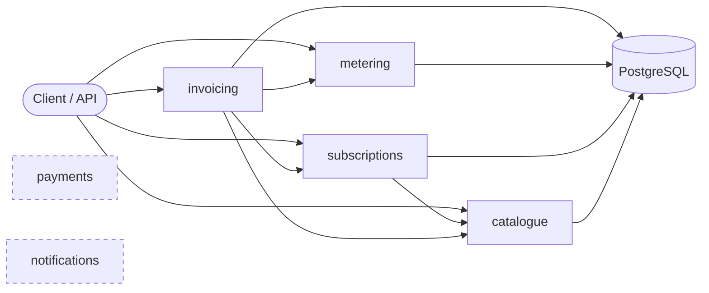
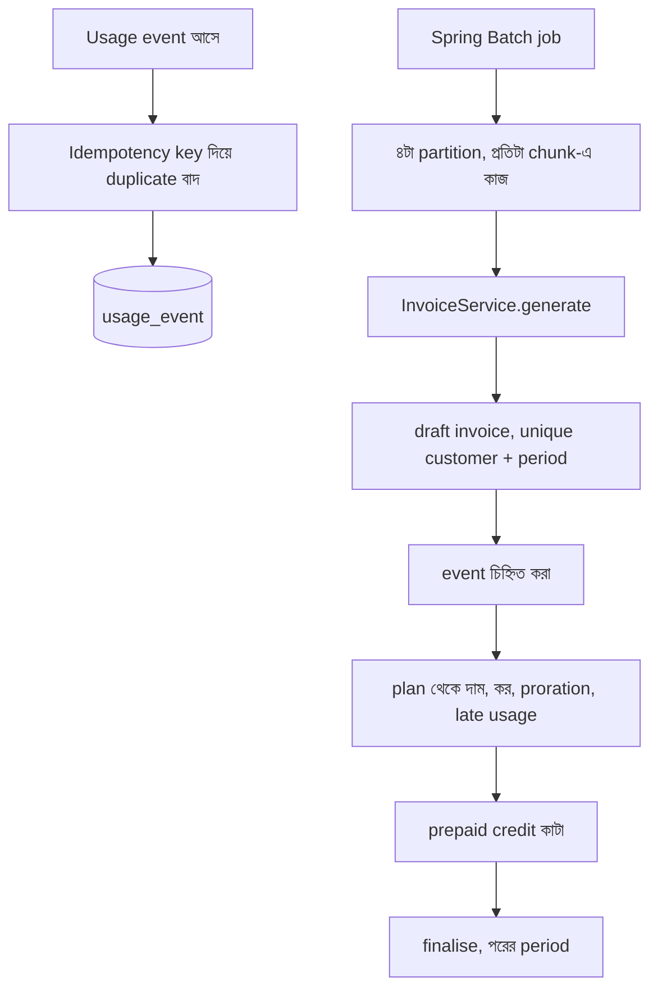

# MeterFlow

SaaS ও API পণ্যের জন্য usage-based billing engine। কাঁচা usage event নেয়, কনফিগারযোগ্য plan অনুযায়ী দাম বসায়, গ্রাহক লাইন ধরে যাচাই করতে পারে এমন invoice বানায়, আর চলতি মাসের আনুমানিক বিল দেখায়।

লক্ষ্য তিনটা: প্রতিটা event ঠিক একবার বিল হবে, প্রতিটা invoice line ব্যাখ্যা করা যাবে, আর নতুন plan কোড নয়, কনফিগারেশনে চালু হবে।

## প্রযুক্তি

| বিষয় | ব্যবহৃত |
|---|---|
| ভাষা | Java 21 |
| Framework | Spring Boot 4.1.2, Spring Web, Spring Batch 6, Spring Modulith |
| ডেটা অ্যাক্সেস | `JdbcTemplate` (সরাসরি SQL)। Spring Data JPA dependency আছে, কিন্তু কোনো JPA repository বানানো হয়নি। কারণ `ON CONFLICT DO NOTHING`, `FOR UPDATE` তালা আর batch insert সরাসরি SQL-এ স্পষ্ট ও নিয়ন্ত্রণযোগ্য |
| ডেটাবেস | PostgreSQL 16 (Docker-এ), Flyway migration |
| Build | Maven (`mvnw`) |

## চালানোর নিয়ম

**আগে লাগবে:** Java 21, Docker Desktop (চালু অবস্থায়)।

```powershell
# ১. ডেটাবেস চালু
docker compose up -d

# ২. সব test চালানো (ডেটাবেস চালু থাকতে হবে)
.\mvnw test

# ৩. app চালানো (http://localhost:8080)
.\mvnw spring-boot:run
```

ডেটাবেসের তথ্য: database `meterflow`, user `meterflow`, password `meterflow`, port `5432`। শেখার প্রজেক্ট, তাই সহজ পাসওয়ার্ড।

**Customer তৈরির API নেই।** Customer সরাসরি ডেটাবেসে বসাতে হয় (নিচের উদাহরণ চালানোর আগে একবার):

```powershell
docker exec -it meterflow-db psql -U meterflow -d meterflow -c "INSERT INTO customer (external_id, name, currency) VALUES ('cust_001', 'Test Customer', 'BDT');"
```

ভারী accuracy test (১০ লাখ event, প্রায় ৪ মিনিট) সাধারণ `.\mvnw test`-এ বাদ থাকে। আলাদা চালাতে:

```powershell
$env:QA_RUN = "true"
.\mvnw test "-Dtest=AccuracyQaTest"
Remove-Item Env:QA_RUN
```

## Architecture

Spring Modulith দিয়ে modular monolith। `ModularityTests` module-এর সীমা যাচাই করে। তীর মানে "এই module ওই module-এর প্রকাশ্য class ব্যবহার করে"।



`shared` module-এ `Money` ও `CurrencyCode` আছে, কিন্তু এখন পর্যন্ত আসল হিসাবে ব্যবহার হয়নি (টাকার পরিমাণ সর্বত্র `BigDecimal`, গোল করা হয় পয়সা পর্যন্ত `HALF_UP` নিয়মে)।

বিল তৈরির প্রবাহ:



## Module কাঠামো

| Module | কাজ |
|---|---|
| `metering` | event নেওয়া (idempotency key, late event), metric-এর aggregation |
| `catalogue` | plan ও charge ধরন (flat, per unit, graduated, volume, package, per seat, free allowance, minimum commitment) |
| `subscriptions` | subscription-এর অবস্থা (trial, active, paused, cancelled), plan বদল ও proration |
| `invoicing` | invoice, কর, credit, credit note, late usage, Spring Batch billing run, live spend ও budget alert |
| `payments` | (ফাঁকা, ভবিষ্যৎ কাজ) |
| `notifications` | (ফাঁকা, ভবিষ্যৎ কাজ) |
| `shared` | `Money`, `CurrencyCode` |

## ব্যবহৃত design pattern

| Pattern | কোথায় |
|---|---|
| Strategy | `catalogue`: প্রতিটা charge ধরন একটা strategy; `metering`: প্রতিটা aggregation (SUM, COUNT, MAX, UNIQUE_COUNT, LATEST) |
| Composite | `Plan`: অনেক charge line মিলে একটা plan, plan নিজেও `Charge` হিসেবে ব্যবহার করা যায় |
| Registry | `ChargeType` ও `ChargeRegistry`: Spring নিজে সব charge ধরন খুঁজে নেয়, তাই নতুন ধরন যোগ করতে পুরনো class বদলাতে হয় না |
| Decorator | `FreeAllowanceCharge`, `MinimumCommitmentCharge`: অন্য একটা charge-কে মুড়ে আচরণ যোগ করে |
| State | `subscriptions`: প্রতিটা অবস্থা আলাদা class |
| Builder | `Invoice.Builder` |

**বানানো হয়নি:** Visitor, Template Method, Observer (প্রশ্নে এগুলো webhook, invoice rendering ও billing ধাপের জন্য ছিল)।

## API তালিকা

| Module | Method ও পথ | কাজ |
|---|---|---|
| metering | `POST /events/batch` | usage event জমা (একবারে সর্বোচ্চ ১,০০০, idempotency key সহ) |
| metering | `POST /metrics`, `GET /metrics/{code}` | billable metric |
| metering | `GET /usage` | usage দেখা |
| catalogue | `POST /plans`, `GET /plans/{code}` | plan বানানো ও দেখা (একই code আবার দিলে নতুন version) |
| catalogue | `POST /plans/{code}/price` | নির্দিষ্ট usage-এ plan-এর দাম হিসাব |
| subscriptions | `POST /subscriptions`, `GET /subscriptions/{id}` | subscription শুরু ও দেখা |
| subscriptions | `GET /subscriptions/{id}/adjustments` | proration সমন্বয় |
| subscriptions | `POST /subscriptions/{id}/pause`, `/resume`, `/cancel` | অবস্থা বদল |
| subscriptions | `POST /subscriptions/{id}/change-plan` | plan বদল (`NOW` বা `PERIOD_END`) |
| subscriptions | `POST /subscriptions/process-trials` | শেষ হওয়া trial প্রক্রিয়া |
| invoicing | `POST /invoices/generate`, `GET /invoices/{id}` | invoice বানানো ও প্রতিটা line-এর ব্যাখ্যা দেখা |
| invoicing | `POST /billing-runs` | সব বিল-যোগ্য subscription-এর run (সরল thread pool সংস্করণ) |
| invoicing | `POST /billing-runs/batch` | Spring Batch run (partitioned, chunk-oriented) |
| invoicing | `POST /credits`, `GET /credits/{customer}` | prepaid credit |
| invoicing | `POST` ও `GET /invoices/{id}/credit-notes` | credit note |
| invoicing | `GET /customers/{customer}/spend` | চলতি period-এর live estimate |
| invoicing | `PUT` ও `GET /customers/{customer}/budget` | budget |
| invoicing | `GET /customers/{customer}/alerts` | ৫০%, ৮০%, ১০০% alert |

## Request body

```json
// POST /events/batch
{ "events": [
  { "customer": "cust_001", "metric": "api_calls", "quantity": 10,
    "timestamp": "2026-11-17T01:00:00Z", "idempotencyKey": "k-1",
    "properties": { "region": "asia" } } ] }

// POST /metrics   (aggregation: SUM, COUNT, MAX, UNIQUE_COUNT, LATEST)
{ "code": "api_calls_total", "name": "API calls", "aggregation": "SUM",
  "eventName": "api_calls", "filters": { "region": "asia" } }
```

Plan-এর body নিচের উদাহরণে আছে। Charge ধরন: `FLAT`, `PER_UNIT`, `GRADUATED`, `VOLUME`, `PACKAGE`, `PER_SEAT`, `FREE_ALLOWANCE`, `MINIMUM_COMMITMENT` (শেষ দুটো ভেতরে `inner` charge নেয়)।

## API উদাহরণ (PowerShell, app চালু ও customer থাকতে হবে)

```powershell
# plan বানানো (gold আর platinum)
Invoke-RestMethod -Uri http://localhost:8080/plans -Method Post -ContentType "application/json" -Body '{ "code": "gold", "name": "Gold", "currency": "BDT", "lines": [ { "description": "Platform fee", "charge": { "type": "FLAT", "fee": "1000" } } ] }'
Invoke-RestMethod -Uri http://localhost:8080/plans -Method Post -ContentType "application/json" -Body '{ "code": "platinum", "name": "Platinum", "currency": "BDT", "lines": [ { "description": "Platform fee", "charge": { "type": "FLAT", "fee": "2000" } } ] }'

# subscription শুরু
$s = Invoke-RestMethod -Uri http://localhost:8080/subscriptions -Method Post -ContentType "application/json" -Body '{ "customer": "cust_001", "planCode": "gold", "startDate": "2026-11-01" }'

# plan বদল ও proration সমন্বয়
Invoke-RestMethod -Uri "http://localhost:8080/subscriptions/$($s.id)/change-plan" -Method Post -ContentType "application/json" -Body '{ "planCode": "platinum", "when": "NOW" }'
Invoke-RestMethod -Uri "http://localhost:8080/subscriptions/$($s.id)/adjustments"

# Spring Batch দিয়ে বিল-যোগ্য সব subscription একসাথে (customerPrefix দিলে শুধু ওই নামে শুরু হওয়া customer)
Invoke-RestMethod -Uri http://localhost:8080/billing-runs/batch -Method Post -ContentType "application/json" -Body '{ "asOf": "2026-12-01", "customerPrefix": "cust_" }'

# credit
Invoke-RestMethod -Uri http://localhost:8080/credits -Method Post -ContentType "application/json" -Body '{ "customer": "cust_001", "amount": 50, "reason": "welcome credit" }'
Invoke-RestMethod -Uri http://localhost:8080/credits/cust_001

# budget ও live spend
Invoke-RestMethod -Uri http://localhost:8080/customers/cust_001/budget -Method Put -ContentType "application/json" -Body '{ "amount": 2000 }'
Invoke-RestMethod -Uri http://localhost:8080/customers/cust_001/spend
Invoke-RestMethod -Uri http://localhost:8080/customers/cust_001/alerts
```

## মান যাচাইয়ের ফল

| লক্ষ্য | ফল |
|---|---|
| সব test | ১৫০টা পাস, ০ fail, ০ error (১টা ভারী test সাধারণ run-এ বাদ) |
| QA1 accuracy | ১০ লাখ event, ৩% duplicate, ২% late: ৩০,০০০ duplicate বাদ, ৯,৭০,০০০ stored, ২,০০০ invoice, স্বাধীন হিসাবের সাথে অমিল ০ (মোট ৮,৬৯,৮৩৯.৪৪) |
| QA2 ingestion | ১০ লাখ event প্রায় ৯৯ সেকেন্ডে (৪ thread, গড়ে প্রায় ১০,০০০ event/সেকেন্ড, সাথে ২০,০০০ late event)। **p95 latency মাপা হয়নি**, তাই ১০০ms-এর শর্ত যাচাই হয়নি |
| QA3 billing run | **গতি:** সরল (thread pool) run-এ ১,০০০ invoice প্রায় ৫১ সেকেন্ড (প্রতিটায় প্রায় ৯৫০ event); Spring Batch সংস্করণ বড় scale-এ মাপা হয়নি, ১০,০০০ customer-ও মাপা হয়নি। **Restart:** মাঝপথে থেমে যাওয়া অনুকরণ করে test করা হয়েছে (আংশিক run-এর পর আবার চালালে বাকিগুলো হয়, কোনো duplicate invoice নেই)। সত্যিকারের process kill করে পরীক্ষা করা হয়নি |
| QA4 pricing agility | `NewChargeTypeTest`: test-এর ভেতরে একদম নতুন charge ধরন যোগ হয়েছে কোনো পুরনো pricing class না বদলে |
| QA5 transparency | `GET /invoices/{id}` এক call-এ প্রতিটা line-এর event সংখ্যা, usage ও দামের নিয়ম দেয়। Live estimate-এর test: `LiveSpendTest` (৪টা)। নিচের সীমাবদ্ধতা দেখো |
| Module সীমা | `ModularityTests` পাস |

## সীমাবদ্ধতা

- Dunning (FR8) ও Webhook (FR9) বানানো হয়নি।
- Plan version simulator (FR10) বানানো হয়নি।
- Live spend-এর customer page নেই, শুধু API।
- Budget alert শুধু ডেটাবেসে লেখা হয়, email বা webhook যায় না।
- Live estimate-এ কর ও proration সমন্বয় ধরা হয়নি, তাই এটা invoice-এর **subtotal**-এর সাথে মেলে, কর সহ মোটের সাথে নয়। কর-প্রযোজ্য customer-এর ক্ষেত্রে মোটের চেয়ে কম দেখাবে।
- Proration শুধু plan-এর নির্দিষ্ট (flat) মাসিক ফি ধরে হিসাব করে।
- Spring Data JPA ব্যবহার হয়নি, `JdbcTemplate` দিয়ে সরাসরি SQL। Optimistic locking আছে (`subscription.version`), idempotency key আছে (unique constraint)।
- Kafka বা outbox queue নেই; ingestion সরাসরি ডেটাবেসে লেখে, billing থেকে আলাদা করা হয়নি।
- `payments` ও `notifications` module এখনো ফাঁকা।
- Customer ও কর নিয়মের জন্য API নেই, সরাসরি SQL।
- Spring Batch-এ একই `runKey` দিয়ে ব্যর্থ job-এর Batch-নিজস্ব restart পরীক্ষা করা হয়নি। বাস্তবে আবার চালালে (নতুন `runKey`) reader শুধু এখনও বিল না হওয়া subscription পড়ে, তাই বাকিটা শেষ হয়।
- ingestion চলার সময় একই সঙ্গে billing হলে খুব ছোট সময়ের জানালায় একটা late event হয়তো পরের run-এ যায়। দুবার বিল হওয়ার সম্ভাবনা নেই।

## AI সহায়তা

## AI সহায়তা

এই প্রজেক্টের পরিকল্পনা, নকশার সিদ্ধান্ত ও আমি নিজে যাচাই করা অংশের পাশাপাশি কোড লেখা, error ঠিক করা ও README তৈরিতে AI টুলের সাহায্য নেওয়া হয়েছে।

ব্যবহৃত টুল: Claude (Anthropic), এবং 

সব কোড নিজের মেশিনে compile ও test করে যাচাই করা হয়েছে (১৫০টা test )। কোড কীভাবে কাজ করে সেটা আমি ব্যাখ্যা করতে পারি।
